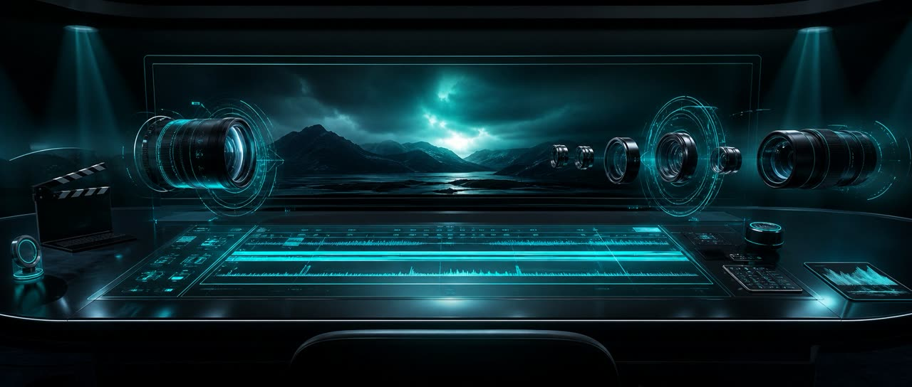
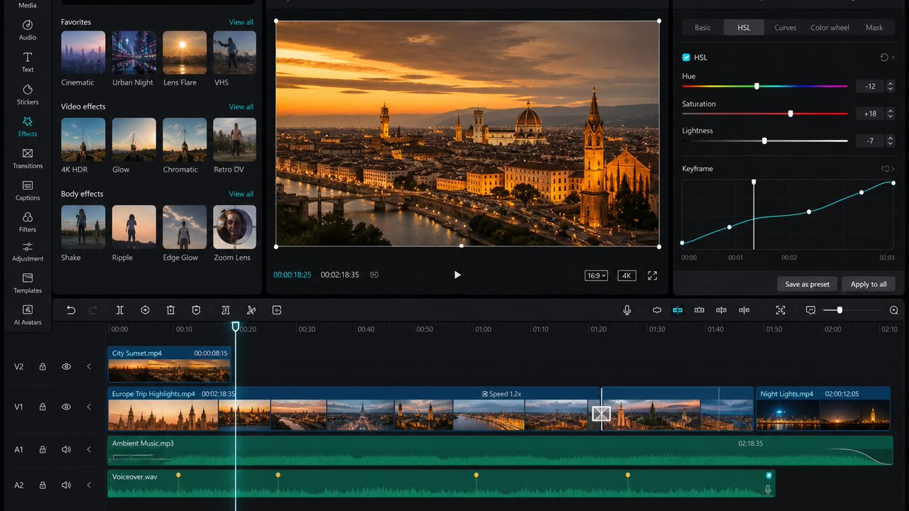
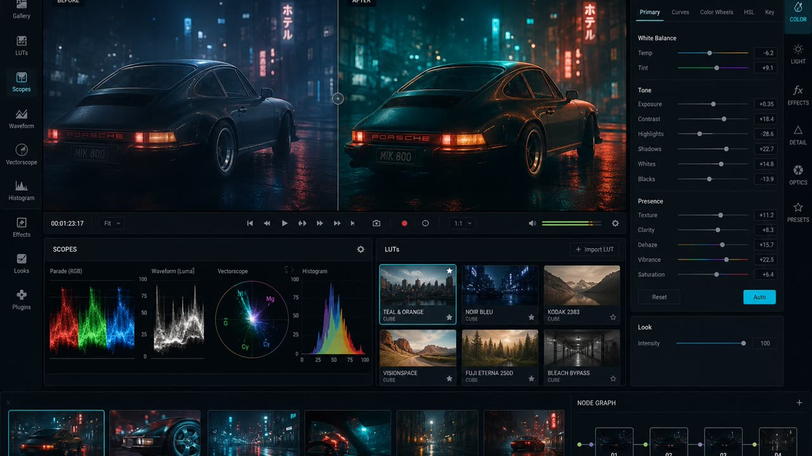
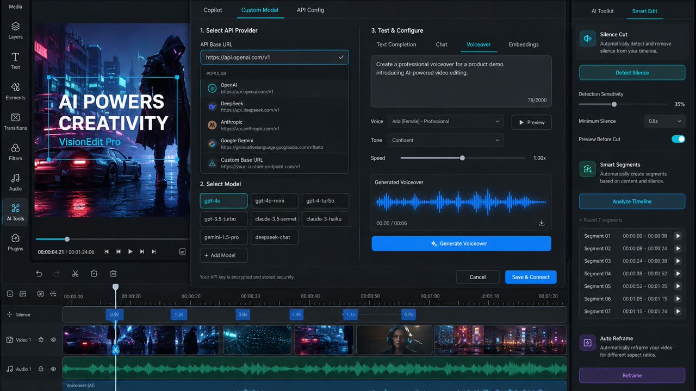
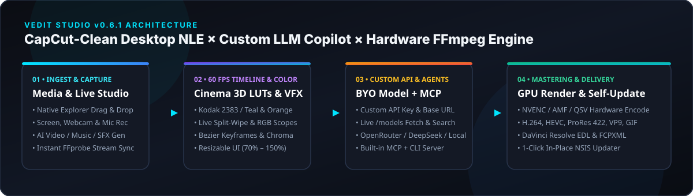

<div align="center">



# Vedit Studio (`v0.6.1`)

**CapCut-Clean Desktop NLE Video Editor for Windows PC • Bring-Your-Own AI Model & Base URL • Cinema 3D `.cube` LUTs & Split-Wipe Scopes • Hardware GPU FFmpeg Render • Built-In MCP Server**

[](https://github.com/lilrepaer-glitch/Vedit/releases/latest)
[](./test)
[](#)
[](#mcp-server-claude-desktop--cursor--ai-agents)

### [⬇ Download `Vedit_installer.exe` (Windows 10 / 11 — Self-Contained, Zero Dependencies)](https://github.com/lilrepaer-glitch/Vedit/releases/latest/download/Vedit_installer.exe)

</div>

---

## Visual Studio Showcase

<p align="center">
  
</p>

<table>
  <tr>
    <td width="50%">
      
      <p align="center"><strong>Cinema 3D <code>.cube</code> LUTs, Split-Wipe Compare &amp; Broadcast RGB Scopes</strong><br/><sub>Kodak 2383, Teal &amp; Orange, Fuji Eterna, Bleach Bypass, Cyberpunk Neon + live Before/After wipe</sub></p>
    </td>
    <td width="50%">
      
      <p align="center"><strong>Custom API Key, Base URL &amp; Model Configurator</strong><br/><sub>OpenAI, OpenRouter, DeepSeek, NVIDIA NIM, Groq, Ollama / LM Studio + live <code>/models</code> search</sub></p>
    </td>
  </tr>
  <tr>
    <td width="50%">
      
      <p align="center"><strong>Built-In 35mm Cinema Plates &amp; Interactive Demo Scenes</strong><br/><sub>One-click demo timelines right inside Vedit's <code>✨ Showcase</code> studio modal</sub></p>
    </td>
    <td width="50%">
      
      <p align="center"><strong>60 FPS GPU Playhead, Speed Ramps, Keyframes &amp; PiP Layouts</strong><br/><sub>Smooth drag splitters, UI scaling (<code>70%–150%</code>), and native Win32 <code>F11</code> Fullscreen</sub></p>
    </td>
  </tr>
</table>

---

## Architecture Overview

<p align="center">
  
</p>

---

## Highlights in `v0.6.1`

- **CapCut-Clean 4-Zone Resizable Studio Workspace**: Dedicated section rail (*Media*, *Audio*, *Text*, *Effects*, *Motion*, *AI Edit*, *AI Gen*, *Studio*), photographic live-filtered LUT/VFX preview cards, universal `Ctrl+K` instant search, smooth drag resizers between all panels, global UI zoom (`70% – 150%`), and top-right native Win32 **Fullscreen (`⛶` / `F11`)**.
- **Interactive Before / After Split-Wipe & Broadcast Scopes**: Compare raw vs. color-graded video directly inside the Player monitor (`⇆ Split Wipe`) alongside live RGB Histograms & IRE Waveforms (`📊 Scopes`).
- **Bring Your Own API Key, Base URL & AI Model (`⚙ API & Model`)**: Connect OpenAI, OpenRouter, DeepSeek, NVIDIA NIM, Groq, Ollama, LM Studio, or any custom OpenAI-compatible `/v1` endpoint with live `/models` discovery, connection testing, and natural-language AI Copilot execution.
- **In-Place NSIS `Update` Installer + 1-Click App Self-Updater**: `Vedit_installer.exe` detects existing installations and updates cleanly in place while keeping all user projects & API settings intact — or update directly from the top bar via **`🔄 Update`**.

---

## One-Line Windows PowerShell Install / Update

```powershell
irm https://raw.githubusercontent.com/lilrepaer-glitch/Vedit/main/vedit-install.ps1 | iex
```

Or download **`Vedit_installer.exe`** directly from **[GitHub Releases](https://github.com/lilrepaer-glitch/Vedit/releases/latest)**.

---

## Quick Start (Development)

```bash
npm ci
npm test                        # Run all 91 end-to-end Vitest tests
npm run build                   # Build TypeScript backend + CLI + MCP
npm run dev:api                 # Start local Vedit Engine on http://127.0.0.1:47000
npm run dev:ui                  # Start React + Vite Studio UI on http://localhost:5173
```

## MCP Server (Claude Desktop / Cursor / AI Agents)

```json
{
  "mcpServers": {
    "vedit": {
      "command": "node",
      "args": ["/path/to/Vedit/dist/mcp/stdio.js"],
      "env": { "VEDIT_PROJECT": ".vedit/project.vedit" }
    }
  }
}
```

## License

MIT
